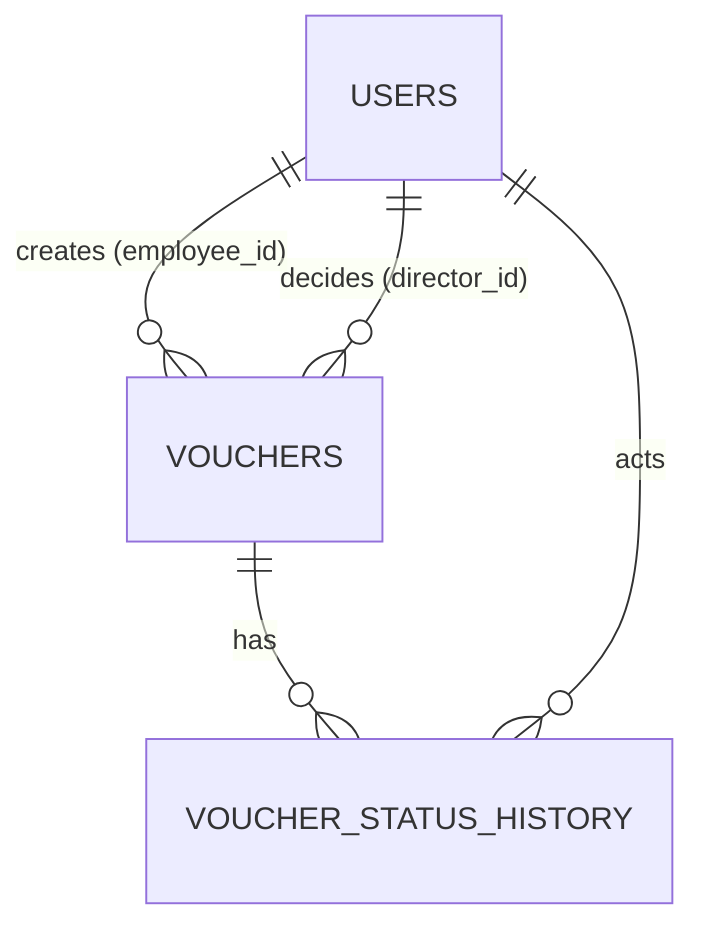

# GITHUB LINK

https://github.com/GaouravPatil/Voucher-Management-System-Prachay-Capital-Pvt-LTD-.git

# Expense Voucher Management System (EVMS)

A web application that digitizes ABC Company's expense voucher process: employees create and submit vouchers, the Director approves or rejects them with a signature, and the Accounts Team monitors everything for reimbursement.

## Features
- Role-based access: **Employee**, **Director (Admin)**, **Accounts Team**
- Voucher lifecycle: Draft → Submitted → Pending Approval → Approved / Rejected
- Auto-generated unique voucher numbers (`VCH-YYYY-NNNNNN`)
- Signature image upload (employee and director), served via authorized endpoints
- Search, filter (voucher no., employee, department, category, status, date range, amount range) and sort
- Role-specific dashboards, status timeline, rejection reasons, print-friendly voucher view
- JWT authentication, server-side authorization, validation on client and server

## Tech stack
React 18 · Vite · TypeScript · Tailwind · React Router · TanStack Query · React Hook Form · Zod | Node.js 20 · Express · TypeScript · pg · JWT · bcrypt · multer | PostgreSQL 15

## Project setup
### Prerequisites
Node.js ≥ 20, npm ≥ 10, Docker (or a local PostgreSQL 15+).

### 1. Clone & install
```bash
git clone <repo-url> && cd expense-voucher-system
cd backend && npm install && cd ../frontend && npm install && cd ..
```
### 2. Database
```bash
docker compose up -d                      # starts PostgreSQL
cp backend/.env.example backend/.env      # edit secrets
cd backend && npm run migrate && npm run seed
```
### 3. Run
```bash
cd backend  && npm run dev     # http://localhost:5000
cd frontend && cp .env.example .env && npm run dev   # http://localhost:5173
```
### 4. Tests / quality
```bash
cd backend && npm test && npm run typecheck
cd frontend && npm test && npm run typecheck
```
### Environment variables
Backend (`backend/.env.example`): `NODE_ENV, PORT, DATABASE_URL, JWT_SECRET (≥32 chars), JWT_EXPIRES_IN, BCRYPT_ROUNDS, CORS_ORIGIN, UPLOAD_DIR, MAX_UPLOAD_MB, APP_TIMEZONE, REVIEWERS_SEE_DRAFTS, LOGIN_RATE_LIMIT_MAX`.
Frontend (`frontend/.env.example`): `VITE_API_BASE_URL`.

### Demo credentials (local only)
| Role | Email | Password |
|---|---|---|
| Director | director@abc.com | Director@123 |
| Accounts | accounts@abc.com | Accounts@123 |
| Employee | emma@abc.com | Employee@123 |
| Employee | ethan@abc.com | Employee@123 |

## Database schema
Tables: `users` (role-based, snapshots), `vouchers` (single table with lifecycle + CHECK constraints BR-8/12/13), `voucher_status_history` (audit/activity feed), `voucher_counters` (race-safe numbering), `schema_migrations`.
- CHECKs enforce: amount > 0, non-blank title/dept, employee sig when submitted, director sig + date when approved, reason when rejected.
- Money: `NUMERIC(12,2)`, returned as decimal strings, sums in SQL.
- Indexes on employee+status, status, dates, dept, category, amount, updated_at, history.

Schema files: `backend/db/migrations/*.sql`, snapshot `backend/db/schema.sql`.

## Workflow
```
Draft → Submitted → Pending Approval → Approved (visible to Accounts for reimbursement)
                                     ↘ Rejected (employee sees reason)
```

## API documentation
Base URL `/api`, Bearer JWT. Error envelope `{ error: { code, message, details } }`.
- `GET /health`, `GET /meta/options`
- Auth: `POST /auth/login`, `GET /auth/me`, `POST /auth/logout`
- Profile: `PUT/GET /users/me/signature`, `GET /users/me/signature/image`, `DELETE /users/me/signature`
- Vouchers: `POST /vouchers`, `GET /vouchers`, `GET /vouchers/pending`, `GET /vouchers/:id`, `GET /vouchers/:id/history`, `PUT /vouchers/:id`, `PUT /vouchers/:id/employee-signature`, `DELETE /vouchers/:id`, `POST /vouchers/:id/submit`, `POST /vouchers/:id/approve`, `POST /vouchers/:id/reject`, `GET /vouchers/:id/signatures/:type`
- Dashboard: `GET /dashboard` (role-specific)
- List query: `page, limit, search, voucherNumber, employeeName, department, category, status, dateField, dateFrom, dateTo, amountMin, amountMax, sortBy, sortOrder`
- Uploads: PNG/JPEG/WEBP, magic-byte verified, ≤2 MB, UUID filename.
See `API.md` / `docs/API.md` for full spec + curl examples.

## Role permissions
| Action | Employee | Director | Accounts |
|---|---|---|---|
| Login | ✅ | ✅ | ✅ |
| Create voucher | ✅ | ❌ | ❌ |
| Edit/Delete/Submit | ✅ own + DRAFT only | ❌ | ❌ |
| List | own only | all (minus drafts by default) | all |
| Approve/Reject | ❌ | ✅ PENDING only | ❌ |
| View signatures | own voucher | ✅ | ✅ |
| Dashboard | own stats | global stats | global stats |

## Validation rules & business rules
Validation (client Zod + server Zod): department required, title 3–150, expense date required + not future, category in list, amount > 0 ≤ 99999999.99 max 2 decimals, employee sig at submit, director sig at approve, rejection reason 5–1000.
Business rules BR-1…BR-13 enforced in service + DB UNIQUE/CHECK + counter transaction + state machine (`voucher.stateMachine.ts`).

## Assumptions
D1: Both SUBMITTED + PENDING_APPROVAL kept; submit writes two history rows. D2: Reviewers hide drafts unless `REVIEWERS_SEE_DRAFTS=true`. D3: REJECTED terminal read-only. D4: Profile signature can be copied to voucher snapshot; per-voucher snapshots immutable. D5: `VCH-YYYY-NNNNNN` per-year counter. D6: Drafts require mandatory fields; signature only at submit. D7: Voucher date = creation date; expense date cannot be future. D8: employee_code optional. D9: Fixed dept/category lists via `/meta/options`. D10: No public registration; seed users only. D11: Paginated lists (default 10, max 100). D12: Print-friendly page with `window.print()`. D13: timestamptz UTC; Director "today" uses `APP_TIMEZONE`.

## Project structure
See `ARCHITECTURE.md` §1 (monorepo `backend/`, `frontend/`, `docs/`, `docker-compose.yml`). Backend layers `routes → controllers → services → repositories → db`. Frontend `api/auth/components/pages/hooks/lib/types`.

## Security notes
JWT in `Authorization` header (localStorage — trade-off documented), bcrypt ≥12, helmet, CORS allowlist, rate-limited login, Zod strict validation, magic-byte upload checks, signatures via authorized endpoints only, parameterized SQL, LIKE escaping, no stack/SQL leaks.

## Verification
- `cd backend && npx tsc --noEmit` ✅ clean
- `cd frontend && npx tsc --noEmit` ✅ clean
- Manual smoke: see `TESTING.md` §I.

## Known limitations / future work
No user-management UI, local disk storage (swap `FileStorage` for S3), no email notifications, no payment-status tracking.
# Voucher-Management-System-Prachay-Capital-Pvt-LTD-
