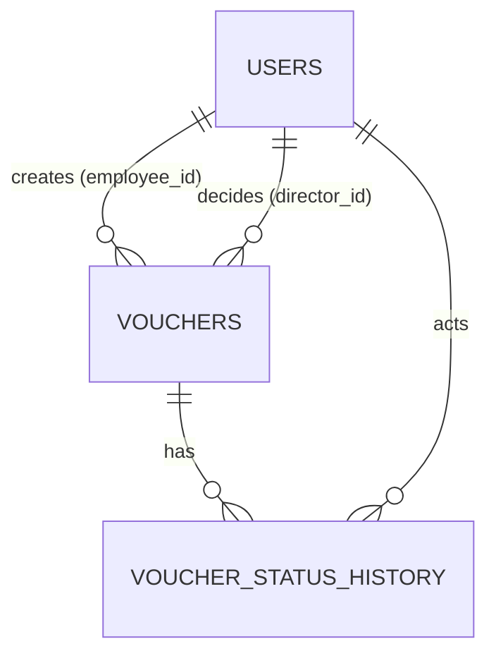

# DATABASE.md — PostgreSQL schema

Implement as ordered SQL migrations in `backend/db/migrations/` and also export `backend/db/schema.sql`. The migration runner records applied files in `schema_migrations(filename, applied_at)`.

## 1. Enums & extensions
```sql
CREATE EXTENSION IF NOT EXISTS pgcrypto;  -- gen_random_uuid()
CREATE TYPE user_role AS ENUM ('EMPLOYEE','DIRECTOR','ACCOUNTS');
CREATE TYPE voucher_status AS ENUM ('DRAFT','SUBMITTED','PENDING_APPROVAL','APPROVED','REJECTED');
```

## 2. users
```sql
CREATE TABLE users (
  id              UUID PRIMARY KEY DEFAULT gen_random_uuid(),
  name            VARCHAR(120) NOT NULL,
  email           VARCHAR(255) NOT NULL,
  password_hash   VARCHAR(100) NOT NULL,
  role            user_role    NOT NULL,
  employee_code   VARCHAR(50),
  department      VARCHAR(100),
  signature_path  VARCHAR(255),              -- optional saved signature
  is_active       BOOLEAN      NOT NULL DEFAULT TRUE,
  created_at      TIMESTAMPTZ  NOT NULL DEFAULT now(),
  updated_at      TIMESTAMPTZ  NOT NULL DEFAULT now()
);
CREATE UNIQUE INDEX users_email_lower_uq ON users (lower(email));
```

## 3. vouchers
```sql
CREATE TABLE vouchers (
  id                      UUID PRIMARY KEY DEFAULT gen_random_uuid(),
  voucher_number          VARCHAR(30)  NOT NULL UNIQUE,            -- VCH-2026-000001
  voucher_date            DATE         NOT NULL DEFAULT CURRENT_DATE,
  expense_date            DATE         NOT NULL,
  department_name         VARCHAR(100) NOT NULL,
  expense_title           VARCHAR(150) NOT NULL,
  expense_category        VARCHAR(60)  NOT NULL DEFAULT 'Miscellaneous',
  expense_description     TEXT,
  amount                  NUMERIC(12,2) NOT NULL CHECK (amount > 0),

  employee_id             UUID NOT NULL REFERENCES users(id),
  employee_name           VARCHAR(120) NOT NULL,                   -- snapshot
  employee_code           VARCHAR(50),                             -- optional
  employee_signature_path VARCHAR(255),

  status                  voucher_status NOT NULL DEFAULT 'DRAFT',
  submitted_at            TIMESTAMPTZ,

  director_id             UUID REFERENCES users(id),
  director_name           VARCHAR(120),                            -- snapshot
  director_signature_path VARCHAR(255),
  approval_date           TIMESTAMPTZ,
  rejection_reason        TEXT,
  rejected_at             TIMESTAMPTZ,

  created_at              TIMESTAMPTZ NOT NULL DEFAULT now(),
  updated_at              TIMESTAMPTZ NOT NULL DEFAULT now(),

  CONSTRAINT chk_title_not_blank   CHECK (length(btrim(expense_title)) > 0),
  CONSTRAINT chk_dept_not_blank    CHECK (length(btrim(department_name)) > 0),
  CONSTRAINT chk_emp_sig_when_submitted
    CHECK (status = 'DRAFT' OR employee_signature_path IS NOT NULL),
  CONSTRAINT chk_dir_sig_when_approved
    CHECK (status <> 'APPROVED' OR (director_signature_path IS NOT NULL AND approval_date IS NOT NULL AND director_id IS NOT NULL)),
  CONSTRAINT chk_reason_when_rejected
    CHECK (status <> 'REJECTED' OR (rejection_reason IS NOT NULL AND length(btrim(rejection_reason)) > 0 AND rejected_at IS NOT NULL))
);
-- auto-update updated_at
CREATE OR REPLACE FUNCTION set_updated_at() RETURNS trigger AS $$
BEGIN NEW.updated_at = now(); RETURN NEW; END; $$ LANGUAGE plpgsql;
CREATE TRIGGER trg_vouchers_updated BEFORE UPDATE ON vouchers FOR EACH ROW EXECUTE FUNCTION set_updated_at();
CREATE TRIGGER trg_users_updated    BEFORE UPDATE ON users    FOR EACH ROW EXECUTE FUNCTION set_updated_at();
```

## 4. voucher_status_history (audit trail + "Recent Voucher Activity")
```sql
CREATE TABLE voucher_status_history (
  id           BIGSERIAL PRIMARY KEY,
  voucher_id   UUID NOT NULL REFERENCES vouchers(id) ON DELETE CASCADE,
  from_status  voucher_status,                 -- NULL for creation
  to_status    voucher_status NOT NULL,
  actor_id     UUID NOT NULL REFERENCES users(id),
  actor_name   VARCHAR(120) NOT NULL,
  actor_role   user_role NOT NULL,
  remarks      TEXT,
  created_at   TIMESTAMPTZ NOT NULL DEFAULT now()
);
```
Hard-deleting a Draft cascades its history (drafts only).

## 5. voucher_counters (race-safe numbering)
```sql
CREATE TABLE voucher_counters (year INT PRIMARY KEY, last_value INT NOT NULL);
-- inside create-voucher transaction:
INSERT INTO voucher_counters(year,last_value) VALUES ($1,1)
ON CONFLICT (year) DO UPDATE SET last_value = voucher_counters.last_value + 1
RETURNING last_value;
-- number = 'VCH-' || year || '-' || lpad(last_value::text, 6, '0')
```

## 6. Indexes
```sql
CREATE INDEX idx_vouchers_employee_status ON vouchers (employee_id, status);
CREATE INDEX idx_vouchers_status          ON vouchers (status);
CREATE INDEX idx_vouchers_expense_date    ON vouchers (expense_date);
CREATE INDEX idx_vouchers_voucher_date    ON vouchers (voucher_date);
CREATE INDEX idx_vouchers_department      ON vouchers (department_name);
CREATE INDEX idx_vouchers_category        ON vouchers (expense_category);
CREATE INDEX idx_vouchers_amount          ON vouchers (amount);
CREATE INDEX idx_vouchers_updated_at      ON vouchers (updated_at DESC);
CREATE INDEX idx_history_created          ON voucher_status_history (created_at DESC);
CREATE INDEX idx_history_voucher          ON voucher_status_history (voucher_id);
-- optional: pg_trgm GIN indexes on lower(employee_name), lower(voucher_number), lower(expense_title)
```

## 7. Seed data (`npm run seed`, idempotent via `ON CONFLICT (lower(email)) DO NOTHING`)
| Role | Name | Email | Password |
|---|---|---|---|
| DIRECTOR | Diana Director | director@abc.com | Director@123 |
| ACCOUNTS | Arjun Accounts | accounts@abc.com | Accounts@123 |
| EMPLOYEE | Emma Employee | emma@abc.com | Employee@123 |
| EMPLOYEE | Ethan Employee | ethan@abc.com | Employee@123 |
Optionally seed sample vouchers in every status (using tiny generated placeholder PNG signatures) behind `npm run seed:demo` so reviewers see populated dashboards. README must list these demo credentials and warn they are for local use only.

## 8. Schema explanation (for README)
Explain: users (role-based, snapshot approach), vouchers (single table with lifecycle columns + CHECK constraints that enforce BR-8/12/13 at DB level), history (audit/activity feed), counters (unique auto numbering), why snapshots of employee/director name & signature are stored per voucher, why NUMERIC for money, index rationale. Include an ER diagram (Mermaid) in README:

